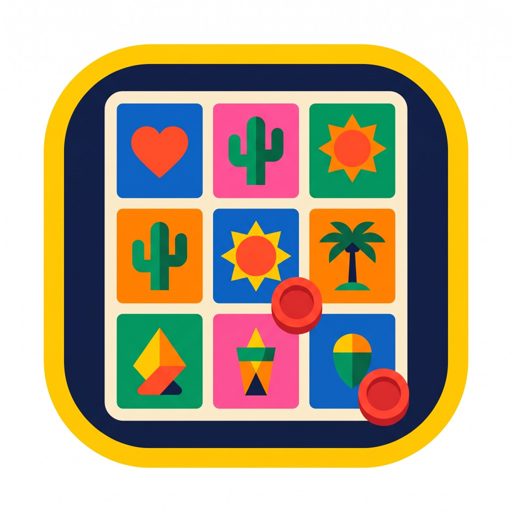

<p align="center">
  
</p>

<p align="center">
  <h1 align="center">Custom Lotería</h1>
  <p align="center">
    <em>Customizable Mexican Lotería board game generator, print studio, and offline digital caller (PWA).</em>
  </p>
  <p align="center">
    <a href="https://brizueia.github.io/custom-loteria/"><strong>🌐 Live App: brizueia.github.io/custom-loteria</strong></a>
  </p>
</p>

<p align="center">
  <a href="LICENSE"></a>
  
  
  
  
  
</p>

---

## ⚡ Highlights

* **🎙️ Interactive Digital Caller (*El Cantador*):**
  Full-featured caller engine with auto-shuffle, adjustable timer intervals, dynamic native voice narration (**Web Speech API** with 4 character pitch/rate profiles + static MP3 sound effects for *"¡Buenas!"*, *"¡Lotería!"*, and card shuffling), live history of called cards, tie-breaker mode (*Carta Mayor*), and celebration confetti.
* **📲 Installable Offline PWA & `IndexedDB` Storage:**
  Installable on Android, iOS, and Desktop as a standalone full-screen app. Stores all 54 high-resolution custom photos locally in **`IndexedDB`** (`loteria_custom_db`), bypassing browser `localStorage` 5 MB limits and isolating each device's deck instance.
* **⚡ Direct PC ↔ Phone Transfer via QR Code (WebRTC P2P):**
  Design your 54-card deck on a computer and transfer it directly to a phone in 2–3 seconds by scanning a live **QR Code** (or entering a 6-character code like `K7M-49P` inside an installed iOS/Android PWA). Powered by `PeerJS` WebRTC DataChannels with 16 KB chunking and FNV-1a checksum verification—no cloud accounts or external servers required.
* **🖨️ WYSIWYG Printable Board & Deck PDF Studio:**
  Algorithmically generates unique player boards (*tablas*) using Fisher-Yates permutations and signature uniqueness checks. Exports print-ready PDFs (Letter or A4) via direct HTML5 Canvas 2D rendering + `jsPDF`, guaranteeing the downloaded PDF matches the live preview 100%.
* **🎨 Visual Customization Studio & Single-File `.json` Backup:**
  Customize frame styles (Botanical Lithography, Traditional Gallo, Talavera, Vintage Poster, Minimal Modern), colors, and typography. Export or import the entire 54-card deck—with all photos embedded in Base64—as a single `.json` file.
* **🔒 Organizer PIN Lock:**
  Lock the app into standalone *Cantador* mode with a customizable PIN so event guests or clients only interact with the caller screen.

---

## 🏛️ Architecture & Stack

* **Framework:** [React 18](https://react.dev/) + [TypeScript](https://www.typescriptlang.org/)
* **Build Tool & Testing:** [Vite 6](https://vitejs.dev/) + [Vitest 5](https://vitest.dev/) (51 unit & integration tests)
* **Styling:** [Tailwind CSS](https://tailwindcss.com/)
* **Persistence & Offline:** `IndexedDB` (`deckStorage.ts`) + Service Worker (`public/sw.js`) + Web App Manifest (`public/manifest.json`)
* **P2P Sync & QR:** [PeerJS](https://peerjs.com/) (WebRTC DataChannel) + [qrcode](https://github.com/soldair/node-qrcode)
* **PDF Rendering:** Direct HTML5 Canvas 2D pipeline + [jsPDF](https://github.com/parallax/jsPDF)

---

## 🚀 Getting Started

### Prerequisites

* [Node.js](https://nodejs.org/) (v20.0.0 or v22.0.0+ recommended)
* `npm`

### Installation

1. **Clone the repository:**
   ```bash
   git clone https://github.com/BrizueIa/custom-loteria.git
   cd custom-loteria
   ```

2. **Install dependencies:**
   ```bash
   npm install
   ```

3. **Start the local development server:**
   ```bash
   npm run dev
   ```

4. Open your browser at `http://localhost:5173`.

---

## 🛠️ Available Scripts

| Command | Description |
| :--- | :--- |
| `npm run dev` | Starts Vite development server with Hot Module Replacement (HMR). |
| `npm test` | Runs the full Vitest unit & integration test suite (51 tests across 10 suites). |
| `npm run test:watch` | Runs Vitest in interactive watch mode. |
| `npm run build` | Runs `tsc` typechecking and builds production-optimized assets in `dist/`. |
| `npm run preview` | Locally serves the production build for verification. |

---

## 📜 Architecture, Governance & Policies

* **[ARCHITECTURE.md](docs/architecture/ARCHITECTURE.md)**: Full system architecture, `IndexedDB` storage, WebRTC P2P transfer protocol, PDF rendering pipeline, and audio caller engine.
* **[SECURITY.md](.github/SECURITY.md)**: Vulnerability disclosure procedure and security policy.
* **[CONTRIBUTING.md](.github/CONTRIBUTING.md)**: Guidelines for contributing code, running tests, and submitting pull requests.

---

## 🎯 Project Structure

```text
custom-loteria/
├── .github/                      # CI/CD workflows & GitHub templates
│   ├── workflows/
│   │   ├── ci.yml                # Automated Test, Typecheck & Build Quality Gate
│   │   └── deploy.yml            # Automated GitHub Pages Deployment
│   ├── ISSUE_TEMPLATE/           # Bug report & Feature request templates
│   ├── CONTRIBUTING.md           # Development & contribution guide
│   ├── pull_request_template.md
│   └── SECURITY.md               # Vulnerability reporting policy
├── docs/
│   └── architecture/
│       └── ARCHITECTURE.md       # System design & protocol specifications
├── public/                       # Static PWA assets, icons & audio clips
│   ├── audio/                    # MP3 sound effects (buenas, loteria, barajar, aplausos)
│   ├── manifest.json             # PWA Web App Manifest
│   └── sw.js                     # Offline Service Worker (Cache-First & Stale-While-Revalidate)
├── src/
│   ├── __tests__/                # End-to-end component integration tests
│   ├── components/               # Modular UI components
│   │   ├── BoardGeneratorSettings.tsx  # Board layout & live preview studio
│   │   ├── CantadorView.tsx            # Digital caller screen & voice settings
│   │   ├── CardPreview.tsx             # Responsive card renderer (board / grid / full)
│   │   ├── CardsGridView.tsx           # 54-card adaptive desktop/mobile grid
│   │   ├── CardStyleSelector.tsx       # Frame, border, and typography controls
│   │   ├── DownloadPDFView.tsx         # Print PDF exporter, PWA installer & event lock
│   │   ├── GeneratorView.tsx           # 4-step deck & board creation wizard
│   │   ├── PasswordModal.tsx           # Organizer PIN verification & change modal
│   │   ├── QRTransferModal.tsx         # P2P WebRTC QR sender & 6-char code receiver
│   │   └── SwipeCardEditor.tsx         # Card-by-card mobile/desktop inspector
│   ├── data/
│   │   └── defaultCards.ts             # 54-card traditional Mexican Lotería starter deck
│   ├── i18n/
│   │   ├── LanguageContext.tsx         # Bilingual (ES/EN) context provider
│   │   └── translations.ts             # Full Spanish & English dictionary
│   ├── types/
│   │   └── loteria.ts                  # TypeScript domain interfaces
│   ├── utils/
│   │   ├── __tests__/                  # Unit tests for all core utilities
│   │   ├── audioCantador.ts            # Native Web Speech TTS + static/procedural audio engine
│   │   ├── deckIO.ts                   # Single-file .json export & schema validation
│   │   ├── deckStorage.ts              # High-capacity IndexedDB adapter & migration
│   │   ├── imageOptimizer.ts           # Client-side image compression & resizing
│   │   ├── loteriaEngine.ts            # Fisher-Yates shuffler & unique board generator
│   │   ├── p2pDeckSync.ts              # Chunked WebRTC P2P transfer & FNV-1a checksum
│   │   ├── pdfGenerator.ts             # Direct Canvas 2D -> jsPDF print renderer
│   │   └── pwaInstaller.ts             # Service Worker registration & install prompt manager
│   ├── App.tsx                   # Top-level state orchestrator, PIN guard & URL sync router
│   ├── main.tsx                  # React root & PWA initializer
│   └── index.css                 # Tailwind layers & typography rules
├── index.html
├── package.json
├── tsconfig.json
├── vite.config.ts
└── vitest.config.ts
```

---

## 📄 License

Licensed under the **Apache License, Version 2.0**. See the [LICENSE](LICENSE) and [NOTICE](NOTICE) files for details.

Copyright © 2026 Brizuela.
